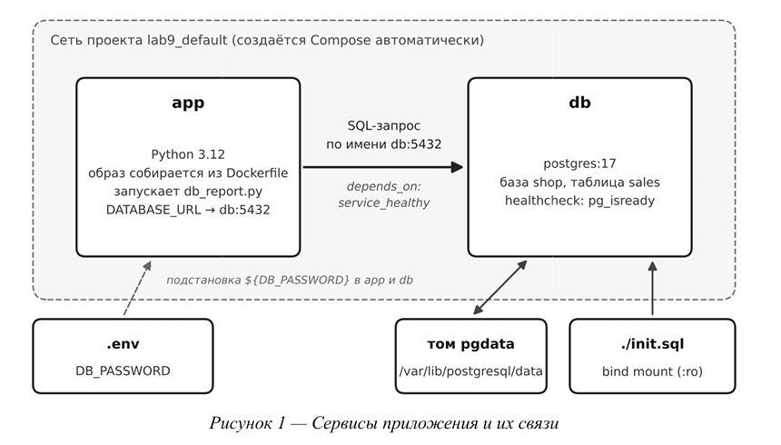

<div align="center">

# 🐋 Лабораторная работа 9

### Docker Compose: запуск многоконтейнерного приложения

`Дисциплина «Облачные технологии и виртуализация»` · `продолжение лабораторной № 8 «Dockerfile` · `собственный образ»`


**Студент:** Маликов Нурдаулет  
**Тема:** Docker Compose  
**Специальность:** Прикладная статистика и Data Science  
**Проверил(а):** Тихонова О. А.  
**Репозиторий:** [MalikovNurdaulet/VOT-lab9](https://github.com/MalikovNurdaulet/VOT-lab9)

</div>

## 📌 1. Цель работы

Научиться описывать, запускать и управлять многоконтейнерным приложением с помощью 
Docker Compose: организовывать взаимодействие сервисов, хранить данные PostgreSQL в 
томе, передавать настройки через переменные окружения и проверять работоспособность 
системы.

## 2. Задачи работы
- изучить структуру файла compose.yaml;
- описать два сервиса: PostgreSQL и Python-приложение;
- использовать собственный Dockerfile из лабораторной № 8;
- настроить взаимодействие контейнеров по имени сервиса;
- организовать постоянное хранение данных PostgreSQL;
- использовать файл .env для настройки приложения;
- настроить healthcheck и зависимости сервисов;
- изучить команды docker compose up, down, logs, ps, exec, run;
- проверить сохранность данных после перезапуска;
- выполнить самостоятельное изменение конфигурации

## 3. Теоретические сведения 
### 3.2. Dockerfile, Docker Engine и Docker Compose 
| Инструмент | Назначение |
|---|---|
| Dockerfile | Описывает, как собрать образ приложения  | 
| Docker Engine  | Создаёт и запускает контейнеры |
| Docker Compose  | Управляет несколькими взаимосвязанными сервисами  |

### 3.3. Что такое сервис 
```bash
services: 
    db `база данных PostgreSQL из готового образа`: 
        image: postgres:17 
    app: 
        build: .
```
db = `база данных PostgreSQL из готового образа`  
app = `наше Python-приложение, образ которого собирается из Dockerfile.`

### 3.4. Структура файла compose.yaml
```bash
services: 
    db: 
        image: postgres:17 
        environment: 
            POSTGRES_PASSWORD: student123 
        volumes:
            - pgdata:/var/lib/postgresql/data 
    app: 
        build: . 
        depends_on: 
        - db 
volumes: 
    pgdata:
```

### 3.5. Сети Docker Compose
```bash
    ports: - "127.0.0.1:5433:5432"
```
5433 = `порт компьютера`  
5432 = ` порт внутри контейнера.`  

### 3.6. Хранение данных: volumes и bind mounts
```bash
services: 
    db: 
        image: postgres:17 
        volumes:
            - pgdata:/var/lib/postgresql/data 
    volumes: 
        pgdata: 
```
### 3.7. Переменные окружения и файл .env
```bash
environment: 
    POSTGRES_DB: shop 
    POSTGRES_USER: postgres 
    POSTGRES_PASSWORD: ${DB_PASSWORD}
```
DB_PASSWORD = ` student123`

### 3.8. Порядок запуска и healthcheck 
```bash
environment: 
    image: postgres:17 
    healthcheck: 
        test: ["CMD-SHELL", "pg_isready -h 127.0.0.1 -U postgres -d shop"] 
        interval: 5s 
        timeout: 3s 
        retries: 10
```
### 3.9. Жизненный цикл проекта  
| Команда | Назначение |
|---|---|
| docker compose up | Создать и запустить сервис  | 
| docker compose up -d | Запустить в фоновом режиме |
| docker compose up --build | Собрать образы и запустить сервисы  |
| docker compose up  ps -a | Показать контейнеры проекта, включая завершённые  | 
| docker compose up logs | Просмотреть журналы |
| docker compose up exec db sh | Выполнить команду в работающем контейнере  |
| docker compose up run --rm app | Запустить разовый контейнер сервиса   | 
| docker compose up stop | Остановить контейнеры без удаления  |
| docker compose up down | Остановить и удалить контейнеры и сети проекта  |
| docker compose up down v | Дополнительно удалить именованные тома проекта и анонимные тома  | 

## 4. Архитектура приложения 



## 5. Подготовка проекта
### Структура проекта:
```text
lab9/
├── compose.yaml
├── Dockerfile 
├── requirements.txt 
├── report.py 
├── db_report.py 
├── init.sql 
├── .env 
└── .dockerignore 
```


# 🐧 Linux server
## Система
- Ubuntu 24.04 LTS
- В качестве виртуальной машины использован облачный VPS-сервер с операционной системой Ubuntu 24.04 LTS. Доступ к серверу осуществляется удалённо по протоколу SSH.V
- 2 vCPU · 4 GB RAM · 40 GB SSD · 200 Mbps


```console
root@hiplet-123755:~# ls
errors.log  lab7  lab8  lab9  linux_lab
root@hiplet-123755:~#
```
